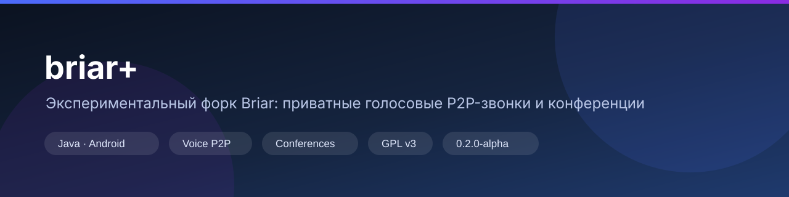

  

# briar+

**RU** · [English](#english)

> Экспериментальный форк [Briar](https://code.briarproject.org/briar/briar). Цель — приватные голосовые P2P-звонки, конференции, публичные и приватные форумы и опциональная биометрическая разблокировка.

| 🧭 Раздел | О чём |
| --- | --- |
| [Состояние 0.2.0-alpha.1](#состояние-020-alpha1) | Что уже есть в исходниках, что осталось в разработке |
| [Карта репозитория](#карта-репозитория) | Где что лежит: api, android-прототип, docs |
| [Лицензия](#лицензия) | GNU GPL v3, унаследованная от Briar |
| [English](#english) | English version |

## Состояние 0.2.0-alpha.1

В исходниках есть интерфейсы голосовых звонков и Android-прототип, который записывает и тут же воспроизводит звук на том же устройстве. Сетевой вызов, сигнализация, Opus, интерфейс звонка, конференции и биометрия остаются задачами разработки. Публичные и приватные форумы относятся к плану развития поверх существующих возможностей Briar.

Этот снимок предназначен для разработки. APK, прохождение тестов и работа между устройствами при переносе не проверялись. В снимке сохранён исходный Android application ID Briar, поэтому он требует замены перед распространением собственной сборки.

## Карта репозитория

| Где | Что находится |
| --- | --- |
| [briar-api](briar-api/src/main/java/org/briarproject/briar/api/plus/voice/) | Интерфейсы, состояния и модели голосовых вызовов |
| [briar-android](briar-android/src/main/java/org/briarproject/briar/android/plus/voice/) | Android-прототип локальной записи и воспроизведения |
| [BRIAR_PLUS.md](BRIAR_PLUS.md) | Исходная записка к alpha-версии |
| [Технический аудит 0.2](docs/audit/BRIAR_PLUS_TECHNICAL_AUDIT.md) | Результаты предыдущего аудита и критерии приёмки |
| [Дорожная карта](docs/ROADMAP.md) | Последовательность разработки и проверки |
| [Происхождение и изменения](docs/SOURCE-IMPORT.md) | Архивы, лицензия и перечень изменений |
| [Upstream README](docs/upstream/README.md) | Оригинальная документация Briar |

## Лицензия

В основе проекта лежит Briar. Применимые условия GNU GPL v3 и исходные уведомления сохранены в [LICENSE.txt](LICENSE.txt) и в самих компонентах. Изменения форка перечислены в [описании импорта](docs/SOURCE-IMPORT.md).

## English

> An experimental fork of [Briar](https://code.briarproject.org/briar/briar). The goal: private P2P voice calls, conferences, public and private forums, and optional biometric unlocking.

### Status 0.2.0-alpha.1

The sources already contain the voice-call interfaces and an Android prototype that records and immediately plays the sound back on the same device. Networked calls, signaling, Opus, the call UI, conferences and biometrics remain development tasks. Public and private forums belong to the roadmap built on top of Briar's existing features.

This snapshot is meant for development. APK builds, test runs and cross-device operation after porting were not verified. The snapshot keeps Briar's original Android application ID, so it has to be replaced before distributing your own build.

### Repository map

| Where | What's there |
| --- | --- |
| [briar-api](briar-api/src/main/java/org/briarproject/briar/api/plus/voice/) | Interfaces, states and models of voice calls |
| [briar-android](briar-android/src/main/java/org/briarproject/briar/android/plus/voice/) | Android prototype of local record-and-playback |
| [BRIAR_PLUS.md](BRIAR_PLUS.md) | The original note for the alpha release |
| [Technical audit 0.2](docs/audit/BRIAR_PLUS_TECHNICAL_AUDIT.md) | Results of the previous audit and acceptance criteria |
| [Roadmap](docs/ROADMAP.md) | The sequence of development and verification |
| [Origin and changes](docs/SOURCE-IMPORT.md) | Archives, license and the list of changes |
| [Upstream README](docs/upstream/README.md) | The original Briar documentation |

### License

Briar is the foundation of this project. The applicable GNU GPL v3 terms and the original notices are preserved in [LICENSE.txt](LICENSE.txt) and in the components themselves. The fork's changes are listed in the [import description](docs/SOURCE-IMPORT.md).

---

#briar #briar-plus #p2p #voice-calls #conferences #forums #biometric-unlock #android #privacy #experimental #gpl-v3
